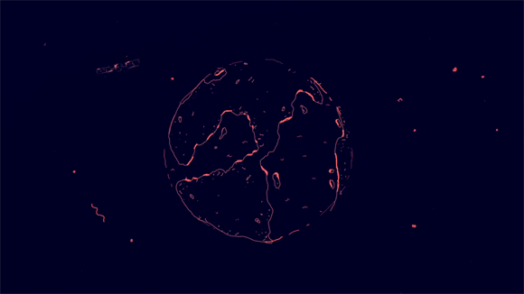

    

<table>
  <tr>
    <td width="55%" valign="top">

## ⭒ About me ⭒

I’m a second-year Multiplatform Application Development student. I love web and app design, and I’m always tinkering with new ways to make interfaces feel fresh and a bit more fun to use. Always learning, always trying something new.

</td>
    <td width="45%" align="center" valign="middle">

 

</td>
  </tr>
</table>

## Technologies
 
- Languages

- Frameworks & Engines

- Databases

- IDEs

- Tools & software

