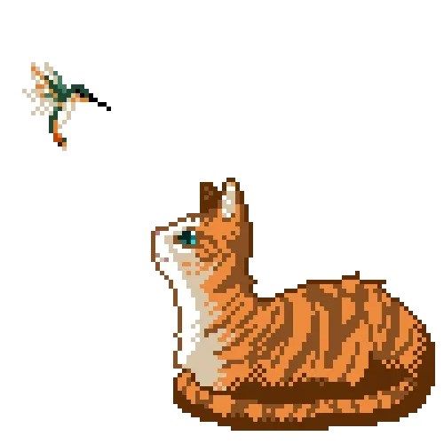
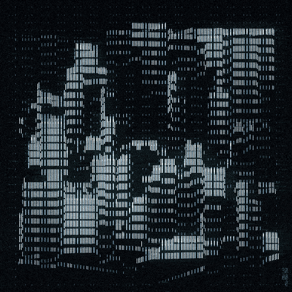

    

<table>
  <tr>
    <td width="60%" valign="top">

## ⭒ About me ⭒

I’m a second-year Multiplatform Application Development student. I love web and app design, and I’m always tinkering with new ways to make interfaces feel fresh and a bit more fun to use. Always learning, always trying something new.

</td>
    <td width="40%" align="center" valign="middle">

</td>
  </tr>
</table>
